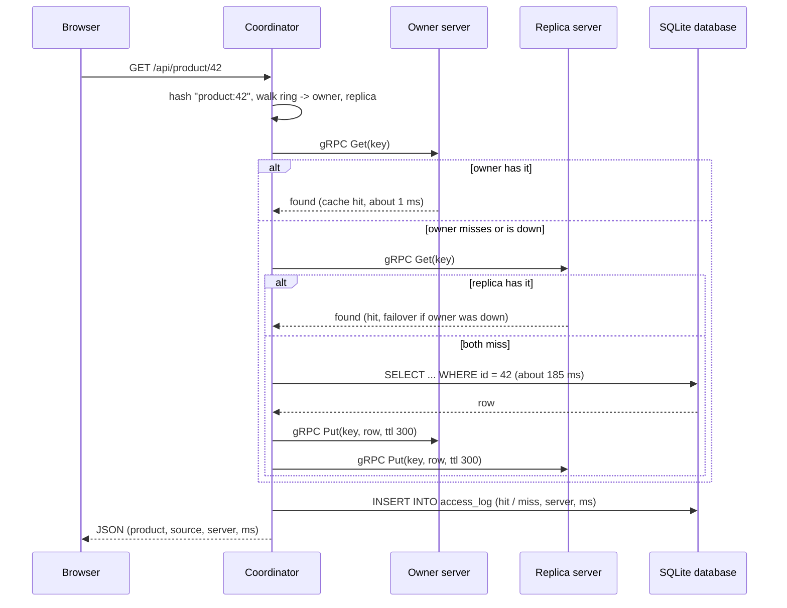
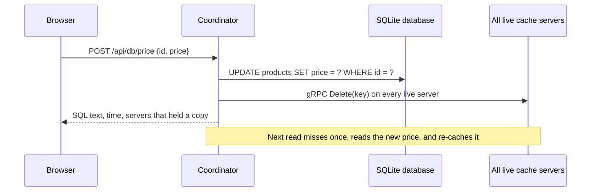
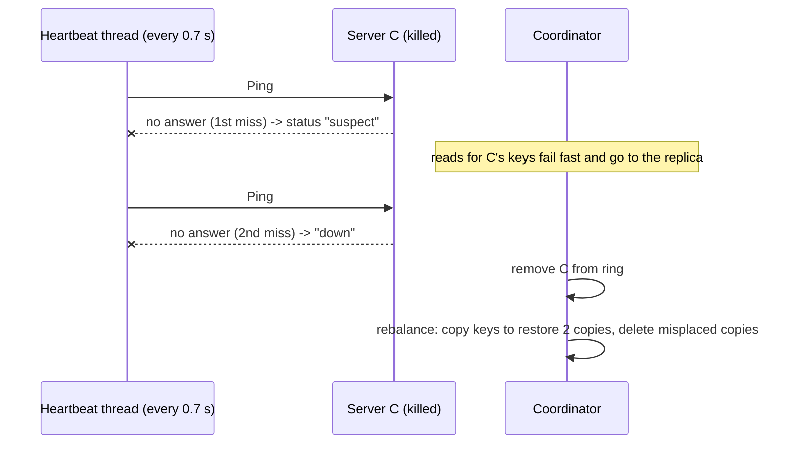

# FlashMart: project context for the report

Everything needed to write the project report for **Topic 9: Distributed Cache with Consistent Hashing** (Distributed Computing micro-project). All numbers in section 11 were measured on the finished system; implementation facts in sections 5 to 9 were checked against the code. Items marked **[fill in]** are for you to supply (names, roll numbers, guide, dates).

Companion files in the project folder: `README.md` (how to run), `EXPLAINED.md` (plain-language explanation, demo script, viva questions).

---

## 1. Project at a glance

| Item | Detail |
| --- | --- |
| Title | FlashMart: a Distributed Cache with Consistent Hashing |
| Subject | Distributed Computing (micro-project) |
| Topic number | 9, "Distributed Cache with Consistent Hashing" |
| Team / guide / date | **[fill in]** |
| Languages and tools | Python 3.14, gRPC 1.85 (`grpcio`, Protocol Buffers), Flask 3.1, SQLite 3, plain HTML/CSS/JavaScript, pytest |
| Platform | Windows 11 laptop, everything on one machine (cache servers are separate OS processes) |
| Size | About 2,900 hand-written lines (1,143 Python backend, 87 test, 1,219 frontend, 50 protobuf) |
| One-line summary | A flash-sale shop whose product pages are served through a cache spread over several gRPC servers, placed by consistent hashing, replicated twice, and backed by a real SQLite database. |

---

## 2. Problem statement and motivation

**Scenario.** An online shop runs a flash sale. Thousands of shoppers open the same small set of product pages at once. Every page needs a database read. In this project a database read costs about 180 ms and gets slower as concurrent load grows, so the database becomes the bottleneck.

**Why a cache.** A cache keeps recent answers in fast memory. A hit costs about 1 ms, so most reads never reach the database.

**Why a *distributed* cache.** One cache server is:
1. a **single point of failure**: if it dies, every read falls back to the slow database and the shop collapses;
2. a **capacity limit**: one machine's memory and network bound the cache size and throughput.

Spreading the cache over several servers fixes both, but raises three distributed-systems questions:

| Question | Technique used |
| --- | --- |
| Which server stores which key? | Consistent hashing with virtual nodes |
| What if a server dies? | Replication (each key on 2 servers), heartbeat failure detection, failover reads |
| What if servers are added or removed? | Rebalancing that moves only about 1/N of the keys |

**Why not `hash(key) % N`.** It is the obvious placement rule, but changing N from 3 to 4 changes the answer for about 75% of keys, which empties most of the cache and floods the database (a cache stampede). Consistent hashing changes only about 1/N of the keys. This difference is the central result the project demonstrates.

---

## 3. Objectives

1. Build a working distributed cache whose nodes are independent processes communicating by RPC (gRPC).
2. Place keys with consistent hashing and virtual nodes, and show how it works step by step.
3. Replicate every key on two servers and keep serving reads when a server is killed.
4. Detect failures automatically (heartbeats) and rebalance after membership changes.
5. Put the cache in front of a real database and show the interaction (read-through on a miss, invalidation on a write).
6. Measure the benefit: latency, hit ratio, database load, keys moved, and failover behaviour.
7. Make all of it visible through a web interface and through backend logs, suitable for a live demonstration.

---

## 4. Theory and background (for the "Literature / Concepts" section)

### 4.1 Cache terminology
- **Hit / miss / hit ratio**, **read-through** (on a miss the application loads from the database and fills the cache), **cache-aside invalidation** (on a write, update the database then delete the cached copy), **TTL** (entries expire), **LRU** (evict least recently used when full).

### 4.2 Remote procedure call and gRPC
RPC lets a program call a function in another process as if it were local. gRPC defines the contract in a `.proto` file; code generation produces a client stub and a server skeleton; messages are serialised with Protocol Buffers and sent over HTTP/2. Here the coordinator is the gRPC client and each cache node is a gRPC server.

### 4.3 Consistent hashing
- A hash function maps both **servers** and **keys** to points on a circle (the ring).
- A key belongs to the first server point met walking **clockwise** from the key's point (the **owner**).
- Adding or removing a server only affects the arc next to it, so about 1/N of keys move.
- **Virtual nodes**: each server is placed at many points (here 40). This evens out each server's share, which would be very uneven with one point per server (see 11.1).
- Original idea: Karger et al., 1997. Used in Amazon Dynamo, Cassandra, Memcached client libraries and many CDNs.

### 4.4 Replication and failure handling
- **Replication factor (RF) = 2**: the owner and the next *different* server clockwise.
- **Failure detection by heartbeats**: periodic pings; a fixed number of consecutive misses declares a node down.
- **Failover read**: if the owner does not answer, ask the replica immediately instead of waiting for detection.
- **Rebalancing**: after membership changes, copy missing replicas and delete data that no longer belongs on a server.

### 4.5 Consistency model
Eventual and best-effort. The database is the source of truth; the cache holds copies with a 300 s TTL. There is no quorum, read repair or versioning (see limitations).

### 4.6 Suggested references (verify details before citing)
1. D. Karger, E. Lehman, T. Leighton, R. Panigrahy, M. Levine, D. Lewin, "Consistent Hashing and Random Trees", ACM STOC, 1997.
2. G. DeCandia et al., "Dynamo: Amazon's Highly Available Key-value Store", ACM SOSP, 2007.
3. I. Stoica et al., "Chord: A Scalable Peer-to-peer Lookup Service for Internet Applications", ACM SIGCOMM, 2001.
4. R. Nishtala et al., "Scaling Memcache at Facebook", USENIX NSDI, 2013.
5. gRPC documentation, https://grpc.io/docs/ ; Protocol Buffers documentation, https://protobuf.dev/
6. SQLite documentation, https://www.sqlite.org/docs.html

---

## 5. System architecture

```
 Browser (Learn / Hashing lab / Shop / Database / Control room / Split view)
        |  HTTP + JSON
        v
 Coordinator  = app.py (Flask) + cluster.py (Cluster)
   - hash ring (hashring.py)        - heartbeats (every 0.7 s)
   - routing, failover, replication - rebalancing on join / leave
   - request log and SQL log        - simulation, tracing for the lab
        |                                   |
        | gRPC (Get, Put, Delete,           | SQL (sqlite3)
        |  Keys, Ping, Stats, Clear)        v
        v                             SQLite database  flashmart.db
 Cache server A   Cache server B   ...        tables: products, access_log, query_log
 (node.py, own process, ports 50051, 50052, ...)
```

**Roles**
- **Coordinator** (one Python process): holds the ring, decides where each key lives, calls the cache servers, detects failures, rebalances, reads and writes the database, serves the web pages and API.
- **Cache servers** (one OS process each, up to 8 named A to H, ports 50051 upward): in-memory key-value store with LRU eviction and TTL, exposed only through gRPC. They share no memory and know nothing about each other.
- **Database**: SQLite file with a simulated network delay (180 ms plus 4 ms per concurrent query).
- **Browser**: a single-page interface that polls `/api/state` every 0.7 s.

**Why the coordinator design.** Routing is centralised for simplicity and visibility in a demo (the ring can be drawn and explained from one place). The trade-off is that the coordinator is a single point of failure (section 12).

**Distribution on one machine.** Each cache server is a real separate process with its own memory and TCP port; they communicate only through gRPC. The same code works across machines by starting `node.py` remotely and attaching it with `app.py --attach D=<ip>:50054` (implemented, not tested on a real network).

---

## 6. Data and control flows (diagrams in Mermaid; render with any Mermaid viewer)

### 6.1 Read path (read-through cache)


### 6.2 Write path (price change, cache-aside invalidation)


### 6.3 Failure handling


### 6.4 Server joins
New server process starts, answers Ping, is added to the ring (40 virtual nodes), then the coordinator lists every cache's keys, copies each key to its new owner/replica, and deletes copies from servers that no longer own it. The number of keys whose owner changed is recorded and compared with what `hash % N` would have moved.

---

## 7. Implementation details by module

### 7.1 `hashring.py` (118 lines): the algorithm
- **Hash function**: MD5 of the key text; the first 8 bytes read as an unsigned 64-bit integer. Ring size is 2^64. Position in degrees = number / 2^64 x 360.
- **Virtual nodes**: for each server `S` and `i` in 0..39, the point is `hash("S#i")`. 40 virtual nodes per server by default (adjustable 1 to 300 live).
- **Lookup**: points kept in a sorted list; `bisect_left` finds the first point at or after the key's hash (wrapping around); that point's server is the owner.
- **Preference list**: continue walking clockwise, skipping virtual nodes of servers already chosen, until `RF` distinct servers are found. Owner first, then replica.
- Also provides `walk()` (every hop with its virtual-node label, used by the lab to explain the walk), `hash_details()` (MD5 hex, 64-bit number, fraction, angle), `copy()` (for what-if previews) and `modulo_owner()` (the naive `hash % N` baseline).

### 7.2 `node.py` (112 lines): one cache server
- In-memory `OrderedDict` guarded by a lock. Capacity **150 entries**, **LRU** eviction (oldest entry dropped when full), per-entry **TTL** (the coordinator uses 300 s).
- Counters: hits, misses, evictions.
- gRPC server with a 16-thread pool. Run as `python node.py --name A --port 50051`.
- `Get` has an `internal` flag so rebalancing reads do not distort hit/miss statistics.

### 7.3 `cache.proto` (50 lines): the RPC contract
Service `CacheNode` with seven calls:

| RPC | Purpose |
| --- | --- |
| `Get(key, internal)` | Return value if present |
| `Put(key, value, ttl_seconds)` | Store a value |
| `Delete(key)` | Remove a key (used for invalidation and rebalancing) |
| `Keys()` | List stored keys (used by rebalancing and the dashboard) |
| `Ping()` | Liveness check and uptime (heartbeats) |
| `Stats()` | Size, capacity, hits, misses, evictions |
| `Clear()` | Empty the cache (demo reset) |

Stubs are generated into `cache_pb2.py` and `cache_pb2_grpc.py` with `grpc_tools.protoc`.

### 7.4 `cluster.py` (488 lines): the coordinator logic
- **Membership**: a `Member` per server (host, port, process handle, status `up`/`suspect`/`down`, in-ring flag, gRPC channel). Servers are spawned as subprocesses; remote servers can be attached by address.
- **Heartbeats**: a background thread pings every server every **0.7 s** with a **0.4 s** timeout. First miss: `suspect`. Second consecutive miss: `down`, removed from the ring, rebalance triggered.
- **Read** (`fetch_product`): described in 6.1. gRPC call timeout 0.3 s for reads so a dead owner is skipped quickly; 0.5 s for writes. A failed owner marks it `suspect` immediately.
- **Rebalance** (`_rebalance`): for every key present on any live server, compute the desired preference list, copy the value to desired servers that lack it, delete it from servers that should not hold it. Returns copy and delete counts.
- **Membership-change measurement** (`_membership_change`): takes ring and modulo owners of all 200 products before and after the change and records how many moved under each method, plus the exact lists of moved keys.
- **Lab support**: `locate()` (read-only lookup), `trace()` (lookup plus a real cache and database read), `simulate()` (preview a join or leave on a copy of the ring), `evict()`, `update_price()`.
- **Concurrency**: a single re-entrant lock protects ring and membership state; cache RPCs themselves run outside the lock on the read path.

### 7.5 `db.py` (170 lines): the database
- **Real SQLite file** `flashmart.db`, rebuilt from seed data on every app start. WAL journal mode (so other tools can read while the app writes) and `synchronous=OFF` (cheap logging).
- Table `products(id, name, category, price, stock)` with 200 deterministic rows.
- **Simulated remote database latency**: each query sleeps `180 ms + 4 ms x queries currently in flight`, so the database slows under load, which is what makes the cache valuable.
- Table `access_log(id, ts, key, result, server, ms, failover)`: one row per lookup. `result` is `hit`, `miss` or `bypass` (cache switched off).
- Table `query_log(id, ts, sql, ms, why)`: one row per SQL statement the app ran.
- `run_select()` powers the read-only SQL console: opens a separate read-only connection (`mode=ro`, `PRAGMA query_only=ON`) and rejects anything not starting with `SELECT` or `WITH`.
- Backend console output: every request prints `HIT` / `MISS` / `BYPASS`, every statement prints `SQL`, cluster changes print `EVENT` (`--quiet` disables).

### 7.6 `app.py` (181 lines): HTTP API (Flask)

| Route | Purpose |
| --- | --- |
| `GET /` | Single-page UI |
| `GET /api/state` | Whole cluster state for the dashboard (servers, ring points, 200 key positions, metrics, events) |
| `GET /api/product/<id>` | Read a product through the cache |
| `GET /api/catalog` | All product rows (shop grid and database table) |
| `GET /api/locate?key=` | Hash and clockwise walk for any key (no side effects) |
| `GET /api/trace?key=` | Same plus a real cache/database lookup for `product:N` keys |
| `GET /api/simulate?action=add\|remove&name=` | Preview a membership change |
| `POST /api/nodes` | Add/revive or kill a server |
| `POST /api/settings` | Cache on/off, number of virtual nodes |
| `POST /api/traffic` | Run simulated flash-sale traffic (1 to 3000 requests, up to 64 workers, skewed popularity) |
| `POST /api/evict` | Remove a key from all caches |
| `POST /api/reset` | Clear caches and counters |
| `POST /api/db/price` | `UPDATE` a price and invalidate cached copies |
| `GET /api/db/log`, `GET /api/db/access`, `POST /api/db/sql` | SQL log, hit/miss log, read-only SQL console |

### 7.7 Frontend (`templates/index.html`, `static/app.js`, `static/lab.js`, `static/app.css`)
Six tabs in one page, no framework. The ring is drawn as SVG: a coloured band shows which server owns each arc, outer ticks are virtual nodes, inner dots are the 200 products (filled when cached), white pulses mark live requests, white rings mark keys that changed owner.

| Tab | What it shows |
| --- | --- |
| Learn | Concept overview, live ring with a "where does this key go?" lookup, four-step explainer, architecture strip |
| Hashing lab | Step-by-step trace of one key (key, MD5, ring position, clockwise walk, owner, replica, cache, SQL, store); before/after preview of adding or removing a server beside `hash % N` with two 200-square grids; key map sorted by ring position |
| Shop | Product grid, auto-shopper, "last page load" panel showing each hop and time |
| Database | The `products` table with which servers hold each row, read and edit, SQL log, every hit and miss, read-only SQL console |
| Control room | Live ring, four metrics, guided five-step demo, per-server cards, keys-moved comparison, manual controls, event log |
| Split view | Shop and Control room side by side for presenting |

### 7.8 `show_db.py` (74 lines)
Opens the database file read-only from outside the app: table row counts, first products, hits and misses with average time, hits per server, latest requests and SQL. `--tail` follows new requests live.

### 7.9 Key parameters

| Parameter | Value |
| --- | --- |
| Hash | MD5, first 8 bytes, 64-bit ring |
| Virtual nodes per server | 40 (1 to 300 adjustable) |
| Replication factor | 2 |
| Entry TTL | 300 s |
| Node capacity | 150 entries (LRU) |
| Heartbeat | every 0.7 s, 0.4 s timeout, 2 misses = down |
| Read RPC timeout | 0.3 s |
| Database latency | 180 ms + 4 ms per concurrent query |
| Product catalogue | 200 rows |
| Maximum servers | 8 (A to H), ports 50051 to 50058 |

---

## 8. Features list (for the "Features / Results" section)

1. Real gRPC cache servers as separate processes with LRU and TTL.
2. Consistent hashing with virtual nodes; live adjustable vnode count.
3. Replication (RF 2) and failover reads.
4. Heartbeat failure detection and automatic rebalancing.
5. Join, kill and revive servers while the shop keeps running.
6. Measurement of keys moved (consistent hashing versus `hash % N`) after every membership change, and an interactive preview.
7. Step-by-step visual explanation of one lookup.
8. Real SQLite database with read-through caching and invalidation on writes.
9. Backend visibility: terminal log, `access_log` and `query_log` tables, `show_db.py`, read-only SQL console.
10. Flash-sale traffic generator and a guided demo.

---

## 9. Mapping to Distributed Computing concepts

| Concept | Where it appears |
| --- | --- |
| Remote procedure call | gRPC contract (`cache.proto`), `node.py` servers, `cluster.py` stubs |
| Client-server architecture | Browser to coordinator; coordinator to cache servers |
| Naming and location transparency | Callers ask for a key, not a server; the ring resolves the location |
| Partitioning / sharding | Consistent hashing with virtual nodes |
| Replication | Each key on owner and next server |
| Fault tolerance | Failover reads, rebalancing to restore replicas |
| Failure detection | Heartbeat Ping with missed-count threshold |
| Scalability (elasticity) | Servers added or removed live; only about 1/N of keys move |
| Load balancing | Virtual nodes even out ownership |
| Consistency | Eventual, TTL plus invalidation; database is source of truth |
| Concurrency | gRPC thread pool, Flask threaded server, locks, 24-user traffic simulation |
| Distributed data / transparency of failure | Shoppers see no error when a server dies |

---

## 10. Testing and verification approach

**Automated (pytest, `tests/test_hashring.py`, 10 tests, all passing):** the ring is deterministic regardless of insertion order; preference lists contain distinct servers and start with the owner; replica count is capped by server count; adding a server moves about 1/N of keys, and only to the new server; modulo hashing moves more than 60% of keys; removing a server moves only that server's keys; more virtual nodes give better balance; the clockwise walk stops at distinct servers and labels virtual nodes; hash details match the ring position; ring copies are independent.

**Manual end-to-end (browser and API):** read path (miss then hit), flash-sale traffic, cache off, add server, kill server with continuous reads, revive, vnode slider, hashing-lab trace, join preview, database read, price edit with invalidation, SQL console (including rejecting `DROP TABLE`), `show_db.py` and terminal log.

**Not automated:** the coordinator, gRPC integration and the web interface have no automated tests. State this plainly in the report.

---

## 11. Measured results

Environment: Windows 11 laptop, Python 3.14, grpcio 1.85, 3 cache servers (A, B, C) unless stated, 200 products, 40 virtual nodes, RF 2, simulated database latency 180 ms + 4 ms per concurrent query, traffic from 24 concurrent simulated users with skewed popularity (a few products get most requests). Results vary slightly from run to run.

### 11.1 Ring balance and keys moved (deterministic, computed offline; 2,000 keys)

**Load balance across 3 servers** (ideal share 666.7 keys each):

| Virtual nodes | A | B | C | Max / min | Std dev as % of mean |
| ---: | ---: | ---: | ---: | ---: | ---: |
| 1 | 79 | 1112 | 809 | 14.08 | 65.0 |
| 5 | 447 | 725 | 828 | 1.85 | 24.1 |
| 10 | 513 | 898 | 589 | 1.75 | 25.0 |
| 40 (default) | 541 | 724 | 735 | 1.36 | 13.3 |
| 100 | 639 | 692 | 669 | 1.08 | 3.3 |
| 200 | 635 | 713 | 652 | 1.12 | 5.0 |

More virtual nodes give a much more even split (one point per server is very uneven). Beyond about 100 the gain flattens (200 is not strictly better than 100 for this key sample).

**Keys moved when adding one server** (2,000 keys, 40 virtual nodes):

| Change | Ideal 1/(N+1) | Consistent hashing | `hash % N` |
| --- | ---: | ---: | ---: |
| 2 to 3 servers | 33.3% | 36.8% | 65.5% |
| 3 to 4 | 25.0% | 22.0% | 74.3% |
| 4 to 5 | 20.0% | 20.6% | 80.7% |
| 5 to 6 | 16.7% | 14.1% | 84.2% |
| 6 to 7 | 14.3% | 12.3% | 84.8% |
| 7 to 8 | 12.5% | 11.9% | 88.5% |

**Removing one server** behaves the same way (for example 4 to 3 servers: consistent 22.0% against modulo 74.3%). The shape of the result matches theory: consistent hashing stays near 1/N while modulo hashing approaches 100% as N grows.

**The 200 shop products, 3 to 4 servers:** consistent hashing moved **32 of 200** (16%); `hash % N` would move **151 of 200** (75.5%). Ownership of the 200 products across A, B, C was 57, 67 and 76.

Note: the "modulo" figures are computed on the same keys (which keys would change owner); the project does not run a second cache using modulo placement.

### 11.2 Cache benefit (live system)

| Measurement | Result |
| --- | --- |
| Single read, first (miss, database) over 30 products | mean 188.2 ms (min 187.1, max 189.6) |
| Single read, second (hit, cache) over the same products | mean 0.88 ms (min 0.60, max 1.20) |
| Speed-up of a hit over a miss | about 213 times |
| Flash sale, cache on, 1000 requests, 24 users | hit ratio **75.6%** (756 hits, 244 misses); average 41.6 ms; p95 275.3 ms; 244 database queries; finished in 3.1 s (about 320 requests/s) |
| Flash sale, cache off, 300 requests, 24 users | average **272.8 ms**; p95 276.7 ms; 300 database queries; finished in 3.8 s (about 79 requests/s) |

Reading the results: with the cache the database handled 24% of requests; without it, 100%. Average response time dropped by about 6.5 times and throughput rose by about 4 times in this setup. Without the cache each query waits about 273 ms, close to 180 ms + 4 ms x 24 in-flight queries, which is the overload model in `db.py` working as designed.

Why 244 misses with only 200 products: when several users request an uncached product at the same moment, each one queries the database because there is no request coalescing ("single flight"). This is a useful observation for the discussion.

### 11.3 Membership changes (live system, with the cache warmed by 1000 requests)

| Event | Result |
| --- | --- |
| Add a 5th server | took 0.66 s; consistent hashing moved 43 of 200 keys (21.5%), `hash % N` would have moved 159 (79.5%); 94 cache entries copied to new owners and 94 removed from old ones |
| Revive a killed server | took 0.60 s, rejoined the ring |
| Earlier run, add a 4th server | 32 of 200 moved against 151 (matches 11.1) |

### 11.4 Failure behaviour (live system)

Four reader threads issued reads continuously while the busiest server was killed (its process terminated). Two runs:

| Measurement | Run 1 (server C) | Run 2 (server B) |
| --- | --- | --- |
| Status after kill | `suspect` at about 0.9 s, `down` at about 2.06 s | `suspect` at about 0.8 s, `down` at about 2.07 s |
| Reads issued after the kill | 507 | 339 |
| Reads that returned an error | **0** | **0** |
| Reads served by a replica (failover) | 20 | 20 |
| Client-side latency after kill | p50 4 ms, max 409 ms | max about 315 ms (server-measured) |
| Keys re-assigned when declared down | 61 of 200 (modulo: 140) | 44 of 200 (modulo: 167) |
| Entries copied to rebuild replicas | 107 | 67 |

So with replication factor 2 no request failed during the failure; a small number of reads were answered by the replica while the owner's failure had not yet been detected, and the cost was a one-off spike to roughly 300 to 400 ms (the 0.3 s timeout on the dead owner). Failure detection took about 2 seconds with the configured heartbeat.

---

## 12. Limitations and honest discussion points

1. **Single coordinator.** It holds the ring and routes every request. If it dies the system stops. A production design would replicate it or let clients hold the ring (as memcached client libraries and Cassandra do).
2. **Global lock during rebalancing.** Membership changes hold the coordinator's lock while keys are copied, so reads that need ring information briefly wait (about 0.6 s for a join in these tests).
3. **Simple failure detector.** Fixed-interval heartbeats with a two-miss threshold. No gossip, no adaptive (phi-accrual) detection, and no protection against false positives or network partitions.
4. **Eventual and best-effort consistency.** Writes are not quorum-based; replicas can briefly differ. There is no versioning or read repair. Rebalancing re-writes entries with the default 300 s TTL, so an entry's remaining lifetime is not preserved.
5. **Cache-aside race.** A read that misses can load the old value from the database, then a concurrent price update invalidates the cache, and the slow reader then re-caches the old value until it expires or is invalidated again. This is a known weakness of cache-aside and is not handled.
6. **No request coalescing.** Simultaneous misses for the same key each hit the database (seen as 244 misses on 200 products).
7. **No persistence on cache nodes.** A killed server loses its data; correctness is preserved because the database is the source of truth and replicas exist.
8. **Both replicas lost together** turns those keys into misses until reloaded.
9. **Everything ran on one machine.** The multi-machine option exists but was not exercised, so real network delay, packet loss and partitions were not tested. gRPC channels are unauthenticated and unencrypted (`insecure_channel`).
10. **Simulated database latency.** The database is one local SQLite file with an artificial delay; it is not itself distributed.
11. **Small data set.** 200 products and a per-server capacity of 150 mean LRU eviction rarely triggers in the demo.
12. **Development web server.** Flask's built-in server is used.
13. **Test coverage.** Only the ring is unit-tested; the rest was verified manually.
14. **The keys-moved comparison for modulo hashing is computed, not executed** against a second cache.

### Possible future work
Replicate the coordinator or move the ring to the client; quorum reads and writes with versioning; phi-accrual or gossip failure detection; request coalescing; cache warming on join; hot-key handling; persistence (snapshotting); TLS and authentication; running nodes on separate machines with network fault injection; automated integration tests; a production web server.

---

## 13. Suggested report structure

| # | Section | Content and sources in this file |
| --- | --- | --- |
| 1 | Title page, certificate, acknowledgement | **[fill in]** |
| 2 | Abstract (150 to 200 words) | Draft below |
| 3 | Introduction and motivation | Section 2 |
| 4 | Problem statement and objectives | Sections 2 and 3 |
| 5 | Literature and concepts | Section 4 |
| 6 | System design | Sections 5, 6 and 9 (architecture figure, three sequence diagrams) |
| 7 | Implementation | Section 7 (module table, parameters, API list, database schema) |
| 8 | Testing | Section 10 |
| 9 | Results and analysis | Section 11 with the figures below |
| 10 | Limitations and future work | Section 12 |
| 11 | Conclusion | Draft below |
| 12 | References | Section 4.6 |
| 13 | Appendix | `cache.proto`, key code excerpts, run instructions, screenshots |

### Figures and screenshots to capture
1. Architecture diagram (section 5).
2. Hashing lab: the ring with the white arc and labels for owner and replica, at the "walk clockwise" step.
3. Hashing lab: "After" view of the join preview with the two grids (32 of 200 against 151 of 200).
4. Hashing lab: the SQL step with the exact `SELECT` shown.
5. Control room: ring with a high hit ratio after the flash sale, and the four metric tiles.
6. Control room: a server shown as `down` with failover reads and the "keys moved" panel.
7. Database tab: products table with the "cached on" column, SQL log, access log and the SQL console result.
8. Terminal showing the live `HIT` / `MISS` / `SQL` lines next to the browser, and the output of `python show_db.py`.
9. Charts you can draw from section 11: load balance against number of virtual nodes; keys moved against N (consistent versus modulo); average latency with and without the cache.

### Draft abstract
This project implements a distributed cache with consistent hashing and demonstrates it through FlashMart, a simulated flash-sale shop backed by a real SQLite database. Cache servers run as separate processes and communicate with a coordinator over gRPC. Keys are placed on a hash ring with 40 virtual nodes per server and replicated on two servers; failures are detected by heartbeats and handled by failover reads and automatic rebalancing. On the test setup, the cache served 75.6% of requests during a simulated flash sale, reduced mean response time from 272.8 ms to 41.6 ms, and a cache hit was about 213 times faster than a database read. Adding a server moved 16% to 21% of keys, against about 75% to 80% for modulo hashing, and killing a server caused no failed requests. A web interface explains and visualises each step, and backend logs and database tables record every cache hit and miss.

### Draft conclusion
The project shows that consistent hashing makes a distributed cache elastic and resilient: placement changes affect only about 1/N of keys, virtual nodes balance the load, replication hides single-server failures, and the cache removes most load from the database. Limitations include a single coordinator, simple failure detection and eventual consistency, which would be addressed in a production design.

---

## 14. How to run and reproduce

```bash
cd C:\Ishan\DC_microproject
.venv\Scripts\python app.py             # starts the coordinator and cache servers A, B, C on http://localhost:8000/
.venv\Scripts\python show_db.py         # inspect the database from outside (add --tail to follow live)
.venv\Scripts\python -m pytest -q tests # 10 passing ring tests
```

To regenerate the gRPC stubs after editing `cache.proto`: `python -m grpc_tools.protoc -I. --python_out=. --grpc_python_out=. cache.proto`.

To repeat the measurements in section 11, use the interface (Control room, "Run the demo") or call the API (`POST /api/traffic`, `/api/nodes`, `/api/settings`, `GET /api/state`). When scripting against the app from Windows, use `127.0.0.1` instead of `localhost`: Python's HTTP client tries IPv6 first and waits about 2 s before falling back, which inflates client-side timings.

Project files: `app.py`, `cluster.py`, `hashring.py`, `node.py`, `db.py`, `show_db.py`, `cache.proto`, `cache_pb2.py`, `cache_pb2_grpc.py`, `templates/index.html`, `static/app.js`, `static/lab.js`, `static/app.css`, `tests/test_hashring.py`, `requirements.txt`, `README.md`, `EXPLAINED.md`, `REPORT_CONTEXT.md`. Generated at run time: `flashmart.db` (and its `-wal` and `-shm` files) and `server.log`.

---

## 15. Glossary

| Term | Meaning |
| --- | --- |
| Cache hit / miss | The key was / was not found in the cache |
| Hit ratio | Hits divided by total requests |
| Read-through | On a miss, load from the database and store in the cache |
| Cache-aside invalidation | On a write, update the database and delete the cached copy |
| TTL | Time after which an entry expires (300 s here) |
| LRU | Least recently used entries are evicted first when the cache is full |
| Hash ring | The circle of 2^64 positions on which servers and keys are placed |
| Virtual node (vnode) | One of many ring points belonging to a single server (`C#7` is the 8th point of server C) |
| Owner / replica | First server clockwise from the key / next different server clockwise |
| Replication factor | Number of copies of each key (2) |
| Failover read | Reading from the replica because the owner did not answer |
| Heartbeat | Periodic Ping used to detect failed servers |
| Rebalancing | Moving or copying keys so each lives where the ring says it should |
| Cache stampede | Many requests hitting the database at once after the cache loses its data |
| gRPC / Protocol Buffers | The RPC framework and its message format, defined in `cache.proto` |
| Coordinator | The program that owns the ring and routes requests to cache servers |
